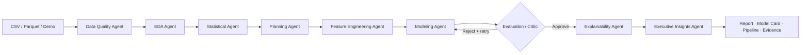

<div align="center">


<p>
  
</p>

[](https://www.python.org/)
[](https://langchain-ai.github.io/langgraph/)
[](https://streamlit.io/)
[](https://fastapi.tiangolo.com/)
[](.github/workflows/ci.yml)
[](LICENSE)

**[Live Demo — add after Streamlit deployment](#deployment)** ·
**[API Docs](#fastapi)** ·
**[Architecture](docs/ARCHITECTURE.md)** ·
**[Security](docs/SECURITY.md)** ·
**[Model Governance](docs/MODEL_GOVERNANCE.md)**

</div>

---

## Why DataPilot AI?

Most “AI data scientist” demos upload a CSV, run preprocessing on the entire dataset, compare
a few models, and ask an LLM to write an impressive-sounding summary. That is fast—but it can
leak test information, exaggerate confidence, and produce insights with no numerical provenance.

**DataPilot AI treats trust as a feature.** It coordinates a stateful agent team that audits the
data, plans the experiment, builds leakage-safe pipelines, compares models, challenges the
winner, explains predictive signals, and exports reproducible artifacts. Every displayed metric
comes from deterministic computation. The optional LLM may improve wording; it cannot create
new numbers or execute code.

### Recruiter five-minute test

1. Open the app.
2. Keep **Iris classification** selected.
3. Click **Run autonomous analysis**.
4. Inspect the model comparison, critic decision, feature importance and full agent trace.
5. Download the fitted pipeline, model card and standalone report.

No account, upload or API key is required.

---

## Product capabilities

| Stage | What DataPilot does | Evidence produced |
|---|---|---|
| Data intake | Accepts bounded CSV/Parquet or one of three packaged sklearn demos | row/column limits and validated schema |
| Data quality | Detects missingness, duplicates, target gaps, imbalance, outliers and leakage-like fields | evidence registry with IDs, source and method |
| EDA | Uses DuckDB and pandas for compact profiles, cardinality and correlations | dataset profile and statistical summary |
| Planning | Infers classification/regression, primary metric, validation strategy and risk controls | typed Pydantic analysis plan |
| Feature engineering | Builds numeric and categorical transformers inside the model pipeline | transformation plan and fitted pipeline |
| Modeling | Compares linear, forest, extra-trees, histogram boosting and optional XGBoost models | holdout and cross-validation results |
| Evaluation | Applies thresholds and validation-consistency checks | critic approval, rejection reasons and retry count |
| Explainability | Uses SHAP when compatible and permutation importance as a reliable fallback | ranked predictive signals and caveats |
| Reporting | Produces a dashboard, evidence-backed narrative and portable artifacts | HTML report, model card, JSON, joblib pipeline |
| Follow-up | Answers questions from persisted run evidence | bounded, non-hallucinatory responses |

---

## Real agentic orchestration

This is not a list of prompts executed in sequence. The critic controls a conditional edge:
weak or unstable analysis returns to the modeling node before explanation is allowed.



The Streamlit **Agent trace** tab shows every completed node, its duration and decision.

---

## Leakage-safe ML design

```python
pipeline = Pipeline(
    [
        ("preprocessor", ColumnTransformer(...)),
        ("model", candidate_model),
    ]
)

# Imputers, encoders and scalers learn only from training folds.
pipeline.fit(x_train, y_train)
```

- Split occurs before learned preprocessing.
- Cross-validation refits the complete pipeline in every fold.
- Classification defaults to balanced accuracy and stratification where possible.
- Holdout and cross-validation results are shown separately.
- Target-like names and identifier cardinality are flagged for human review.
- Predictive importance is never described as causality.

---

## Dashboard experience

The Streamlit application is summary-first and useful before any upload:

- **Built-in demos:** Iris, Breast Cancer and Diabetes Progression.
- **Executive overview:** findings, recommendations and quality risks.
- **Model laboratory:** candidate comparison, CV stability and critic gate.
- **Explainability:** interactive Plotly feature-importance view.
- **Agent trace:** visible orchestration and retry behavior.
- **Artifacts and Q&A:** downloads, evidence registry and run-specific questions.

> Add a real application screenshot to `assets/` after deployment; do not use a fabricated UI
> mockup as evidence of a working demo.

---

## Technology stack

| Layer | Technology |
|---|---|
| Agent orchestration | LangGraph typed state and conditional routing |
| User interface | Streamlit and Plotly |
| API | FastAPI and Pydantic |
| Analytical engine | DuckDB, pandas and NumPy |
| ML | scikit-learn; optional XGBoost and Optuna |
| Explainability | optional SHAP with permutation fallback |
| Persistence | SQLAlchemy; SQLite locally, PostgreSQL in production |
| Experiment tracking | structured agent trace; optional MLflow/OpenTelemetry |
| Artifacts | local storage interface, ready for S3/MinIO replacement |
| Delivery | Docker Compose, Render Blueprint and Streamlit Cloud |
| Quality | Pytest, Ruff, coverage, compile checks and Docker builds in GitHub Actions |

---

## Repository structure

```text
DataPilot-AI/
├── datapilot/
│   ├── config.py             # typed environment configuration and limits
│   ├── data.py               # safe readers, DuckDB overview and sample datasets
│   ├── quality.py            # quality, leakage, imbalance, outlier and drift checks
│   ├── modeling.py           # leakage-safe pipelines and model comparison
│   ├── workflow.py           # LangGraph agent graph and critic loop
│   ├── insights.py           # deterministic + optional evidence-bounded narrative
│   ├── reports.py            # HTML report, model card, pipeline and JSON export
│   ├── persistence.py        # SQL run store and artifact interface
│   ├── observability.py      # optional MLflow integration
│   └── safety.py             # expression-only AST security policy
├── api/main.py               # versioned FastAPI application
├── worker/main.py            # optional isolated calculation worker
├── tests/                    # quality, safety, API and end-to-end workflow tests
├── docs/                     # architecture, deployment, security and governance
├── streamlit_app.py          # recruiter-facing application
├── Dockerfile*               # non-root UI, API and worker images
├── docker-compose.yml        # constrained local multi-service stack
├── render.yaml               # Render API deployment blueprint
└── .github/workflows/ci.yml  # lint, tests, coverage, compile and image builds
```

---

## Quick start

### Local Streamlit demo

```bash
git clone https://github.com/dineshbarri/DataPilot-AI.git
cd DataPilot-AI

python -m venv .venv
# Windows
.venv\Scripts\activate
# macOS/Linux
source .venv/bin/activate

pip install -r requirements.txt
streamlit run streamlit_app.py
```

Open <http://localhost:8501>.

### Full AI/AutoML/observability extras

```bash
pip install -e ".[all,dev]"
```

The default installation intentionally stays deployable on modest public-demo infrastructure.

### FastAPI

```bash
uvicorn api.main:app --reload --port 8000
```

Open <http://localhost:8000/docs>.

Example:

```bash
curl -X POST http://localhost:8000/v1/analyze/sample \
  -H "Content-Type: application/json" \
  -d "{\"sample\":\"iris\"}"
```

### Docker

```bash
docker compose up --build
```

The optional worker runs with no network, a read-only filesystem, dropped capabilities,
memory/CPU/PID limits and expression-only AST validation.

---

## Configuration

Copy `.env.example` to `.env`.

| Variable | Default | Purpose |
|---|---|---|
| `DATABASE_URL` | SQLite | Set a PostgreSQL URL for persistent production runs |
| `ARTIFACT_ROOT` | `artifacts` | Root for reports, pipelines and model cards |
| `MAX_UPLOAD_MB` | `25` | Public upload protection |
| `MAX_ROWS` | `100000` | Maximum rows per analysis |
| `MAX_COLUMNS` | `250` | Maximum feature width |
| `MAX_CRITIC_RETRIES` | `1` | Conditional modeling retry budget |
| `ENABLE_MLFLOW` | `false` | Enable optional experiment tracking |
| `GEMINI_API_KEY` | empty | Optional narrative refinement only |

No credential is embedded in the repository.

---

## Testing and engineering quality

```bash
pip install -e ".[dev]"
ruff check .
pytest --cov=datapilot --cov=api --cov-report=term-missing
python -m compileall datapilot api worker streamlit_app.py
```

CI repeats these checks on Python 3.12 and builds both public-facing Docker images.

---

## Deployment

### Streamlit Community Cloud

- Entrypoint: `streamlit_app.py`
- Python: 3.12
- Secrets: none required; `GEMINI_API_KEY` is optional
- Default recruiter path: bundled demo dataset

### Render / Railway / Fly.io

Deploy `Dockerfile.api`, attach PostgreSQL, and configure durable object storage if artifacts
must survive container replacement. See [the deployment guide](docs/DEPLOYMENT.md).

### Production recommendation

For long jobs, turn the synchronous analysis endpoint into a job API backed by a queue and
separate workers. Use PostgreSQL for state, S3-compatible storage for artifacts, and
short-lived sandboxed workers for any future code-execution capability.

---

## Responsible-use boundaries

DataPilot is an exploratory decision-support system, not an automatic production approval
authority. Before consequential use, complete:

- target and leakage review
- out-of-time and segment evaluation
- privacy and retention assessment
- fairness and disparate-impact evaluation
- domain and legal approval
- monitoring, rollback and retraining ownership

See [Model Governance](docs/MODEL_GOVERNANCE.md) and [Security](docs/SECURITY.md).

---

## Roadmap

- [ ] Background job queue and live progress streaming
- [ ] S3/MinIO artifact adapter with signed downloads
- [ ] Native PostgreSQL checkpoints for resumable LangGraph runs
- [ ] Optuna study dashboard and experiment comparison
- [ ] Time-series and clustering task families
- [ ] Fairness and segment-performance report
- [ ] Data-contract and schema-drift registry
- [ ] Authenticated multi-tenant workspace

---

## Creator

### Dinesh Barri

AI Engineer building agentic systems, data products, RAG applications and production-oriented
machine-learning workflows.

[](https://github.com/dineshbarri)
[](https://www.linkedin.com/in/dinesh-barri-7654b010b)

---

## License

Released under the [MIT License](LICENSE).

If this project helps you, please star the repository and share the live demo.

