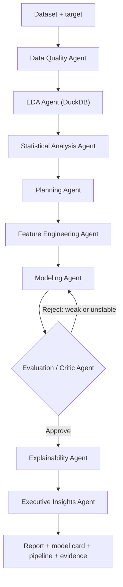

# DataPilot AI Architecture

## Design goals

DataPilot AI separates the user experience, orchestration, analytics, model training,
persistence, and optional restricted computation. The default application remains useful
without a paid model API; every displayed number originates from deterministic computation.

## Runtime components

| Component | Responsibility |
|---|---|
| Streamlit UI | Recruiter demo, upload/sample selection, charts, trace, downloads and Q&A |
| FastAPI | Versioned analysis, run, artifact and evidence-backed Q&A endpoints |
| LangGraph | Stateful agent ordering, state propagation and critic retry routing |
| Analytics core | DuckDB profiling, statistical summaries and data-quality evidence |
| ML core | Leakage-safe sklearn pipelines, model comparison and validation |
| Explainability | SHAP when compatible; permutation-importance fallback |
| Persistence | SQLAlchemy with SQLite locally and PostgreSQL via `DATABASE_URL` |
| Artifact store | Local filesystem interface, replaceable by S3/MinIO |
| Restricted worker | Expression-only AST validation in a networkless, resource-limited container |

## Agent graph

## Leakage controls

1. Rows without labels and exact duplicates are removed before splitting.
2. Train/test split occurs before any learned transformation.
3. Imputation, scaling, and one-hot encoding are inside `sklearn.pipeline.Pipeline`.
4. Cross-validation refits the complete pipeline in every fold.
5. Identifier and target-like features are flagged for human review.
6. Holdout metrics and cross-validation metrics remain distinct.

## Graceful degradation

- Without Gemini: deterministic evidence-backed executive narrative.
- Without SHAP: permutation importance.
- Without XGBoost: sklearn candidate models.
- Without MLflow: structured agent trace plus persisted run JSON.
- Without PostgreSQL: SQLite.

